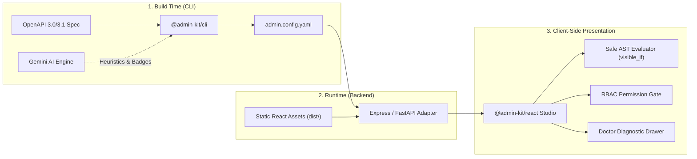

# AdminKit

> Instant, declarative, API-driven admin dashboards generated from your OpenAPI specification.

[](#)
[](LICENSE)
[](https://pnpm.io/)
[](https://turbo.build/repo)

AdminKit inspects any OpenAPI 3.0/3.1 backend specification, synthesizes a declarative configuration file (`admin.config.yaml`), and serves an operational single-page application (SPA) with zero frontend maintenance overhead. It delivers dynamic data tables, role-based access control (RBAC), custom workflow actions (e.g., Approve / Reject), and an in-app diagnostic console.

---

## Architectural Highlights

- **Zero Frontend Maintenance**: Transforms OpenAPI schemas into an operational admin studio without hand-written React code or fragile drag-and-drop canvases.
- **AI Workflow Synthesis**: Infers semantic badge color mappings (green, yellow, red, neutral), conditional action visibility (`visible_if`), sensitive field masks (`sensitive: true`), and normalized human-readable labels using Gemini.
- **Sandboxed Expression Evaluator**: Uses a strict recursive-descent AST interpreter for conditional visibility expressions without invoking `eval()` or `new Function()`.
- **Role-Based Access Control (RBAC)**: Enforces resource, column, and action visibility rules with real-time UI gating and runtime role simulation.
- **Doctor Diagnostic Engine**: Continuously validates schema synchronization, flags missing endpoints, detects unmapped badge enums, and surfaces configuration drift.
- **Framework-Agnostic Adapters**: Native integration with Node.js (Express) and Python (FastAPI / Starlette) with 100% offline, self-hosted static asset delivery.

---

## Architecture & Data Flow



---

## Comparison: AdminKit vs. Alternatives

| Dimension | AdminKit | Retool / Low-Code | Manual React Admin | Swagger UI / Postman |
| :--- | :--- | :--- | :--- | :--- |
| **Setup Time** | Under 2 minutes via CLI | Hours of canvas building | Weeks of boilerplate | Instant, but raw API only |
| **Source of Truth** | Git-tracked `admin.config.yaml` | Proprietary cloud DB | Scattered codebases | OpenAPI document |
| **Code Security** | Zero-eval AST parser | Client-side `eval()` scripts | Custom implementations | N/A (read-only forms) |
| **Drift Detection** | Automated `diff` & `doctor` CLI | Manual reconciliation | Manual test regression | No change alerts |
| **Workflow Actions** | Native RPC buttons & modals | Custom query wiring | Custom form dialogs | Raw HTTP payloads |
| **Hosting Model** | Self-hosted embedded middleware | Proprietary cloud / complex self-host | Custom deployment pipeline | Embedded HTML |

---

## Quickstart Guide

### 1. Introspect API & Generate Configuration

Run the CLI pull command against any local schema file or running API service:

```bash
# Deterministic OpenAPI extraction
npx @admin-kit/cli pull --source=./openapi.json

# Optional: Run with AI enrichment for live badge maps and visibility rules
export GEMINI_API_KEY="your-api-key"
npx @admin-kit/cli pull --source=./openapi.json --ai
```

### 2. Mount Middleware in Your Backend

#### Express (Node.js / TypeScript)

```bash
pnpm add @admin-kit/express express
```

```typescript
import express from "express";
import { mountAdminStudio } from "@admin-kit/express";

const app = express();
app.use(express.json());

// Mount AdminKit Studio at /admin
app.use(
  "/admin",
  mountAdminStudio({
    configPath: "./admin.config.yaml",
  })
);

app.listen(3000, () => {
  console.log("Admin dashboard available at http://localhost:3000/admin");
});
```

#### FastAPI (Python 3.10+)

```bash
pip install admin-kit-fastapi fastapi uvicorn
```

```python
from fastapi import FastAPI
from admin_kit_fastapi import mount_admin_studio

app = FastAPI()

# Mount AdminKit Studio at /admin
mount_admin_studio(
    app,
    path="/admin",
    config_path="admin.config.yaml"
)

if __name__ == "__main__":
    import uvicorn
    uvicorn.run("main:app", host="0.0.0.0", port=8000, reload=True)
```

### 3. Access the Studio

Open your browser and navigate to:
- **Express**: [http://localhost:3000/admin](http://localhost:3000/admin)
- **FastAPI**: [http://localhost:8000/admin](http://localhost:8000/admin)

---

## Configuration Reference (`admin.config.yaml`)

```yaml
version: "1.0"

project:
  name: "Acme Operations"
  logo: "/logo.svg"
  api_base_url: "http://localhost:3000/api"

auth:
  type: bearer
  token_key: "acme_admin_token"
  header_name: "Authorization"

resources:
  - id: refunds
    label: "Refund Requests"
    icon: "banknote"
    endpoint: "/refunds"
    primary_key: "id"

    table:
      searchable: true
      default_sort:
        field: "created_at"
        order: "desc"
      columns:
        - field: "id"
          label: "Refund ID"
          type: "string"

        - field: "user_id"
          label: "Customer"
          type: "relation"
          relation:
            resource: "users"
            display_field: "email"
            foreign_key: "id"

        - field: "amount"
          label: "Amount (USD)"
          type: "currency"

        - field: "status"
          label: "Status"
          type: "badge"
          badge_map:
            pending: "yellow"
            approved: "green"
            rejected: "red"

        - field: "notes"
          label: "Internal Notes"
          type: "string"
          sensitive: true # Masked with click-to-reveal toggle

      row_actions:
        - id: "approve"
          label: "Approve"
          endpoint: "/refunds/{id}/approve"
          method: "POST"
          style: "primary"
          # Safe AST evaluation without eval()
          visible_if: "row.status == 'pending'"
          confirm:
            title: "Approve Refund"
            message: "Issue a refund of ${row.amount} to this customer?"

        - id: "reject"
          label: "Reject"
          endpoint: "/refunds/{id}/reject"
          method: "POST"
          style: "danger"
          visible_if: "row.status == 'pending'"
          confirm:
            title: "Reject Refund"
            message: "Are you sure you want to decline this refund request?"

rbac:
  default_policy: "allow"
  roles:
    support_tier_1:
      permissions:
        - resource: "refunds"
          actions: ["read"]
    finance_manager:
      permissions:
        - resource: "refunds"
          actions: ["read", "approve", "reject"]
```

---

## Monorepo Structure

```text
admin-kit/
├── packages/
│   ├── core/                  # @admin-kit/core: Zod schema, AST evaluator, RBAC, HTTP client
│   ├── cli/                   # @admin-kit/cli: OpenAPI parser, diff engine, AI synthesis
│   ├── react/                 # @admin-kit/react: Dynamic UI engine, TanStack tables, Doctor drawer
│   └── express/               # @admin-kit/express: Express router & static bundle middleware
├── adapters/
│   └── fastapi/               # admin-kit-fastapi: Python Starlette/FastAPI mount adapter
├── examples/
│   ├── express-demo/          # Node.js + Express reference implementation
│   ├── fastapi-demo/          # Python + FastAPI reference implementation
│   └── react-demo/            # Standalone Vite React development harness
├── docs/                      # Architectural specifications and schemas
├── .changeset/                # Release & changelog versioning configuration
├── pnpm-workspace.yaml
├── turbo.json
└── package.json
```

---

## CLI Reference

The `@admin-kit/cli` executable provides end-to-end tooling for configuration management:

```bash
# Initialize a starter template
admin-kit init

# Introspect an OpenAPI spec and write admin.config.yaml
admin-kit pull --source=./openapi.json

# Introspect with AI workflow synthesis (badges, visibility, labels, sensitive fields)
admin-kit pull --source=./openapi.json --ai

# Detect schema drift between your API and local config
admin-kit diff --source=./openapi.json

# Run integrity validation and diagnostic audit
admin-kit doctor

# Launch a zero-dependency local preview server
admin-kit studio --port=3000 --config=admin.config.yaml
```

---

## Development & Testing

### Prerequisites

- Node.js v20+
- pnpm v9+
- Python 3.10+ (for `admin-kit-fastapi`)

### Setup

```bash
# 1. Install dependencies
pnpm install

# 2. Build packages
pnpm build

# 3. Run automated test suites
node --experimental-strip-types --test packages/core/test/config.test.ts packages/core/test/evaluator.test.ts packages/core/test/client.test.ts packages/core/test/rbac.test.ts packages/cli/test/cli.test.ts packages/cli/test/ai.test.ts packages/express/test/express.test.ts
```

### Versioning

This project uses [Changesets](https://github.com/changesets/changesets) for package versioning:

```bash
# Create a changeset
pnpm changeset

# Version packages and update changelogs
pnpm version-packages
```

For detailed contribution workflows and guidelines, see [CONTRIBUTING.md](CONTRIBUTING.md). For our security posture and vulnerability reporting guidelines, refer to [SECURITY.md](SECURITY.md).

---

## License

MIT © AdminKit Contributors
